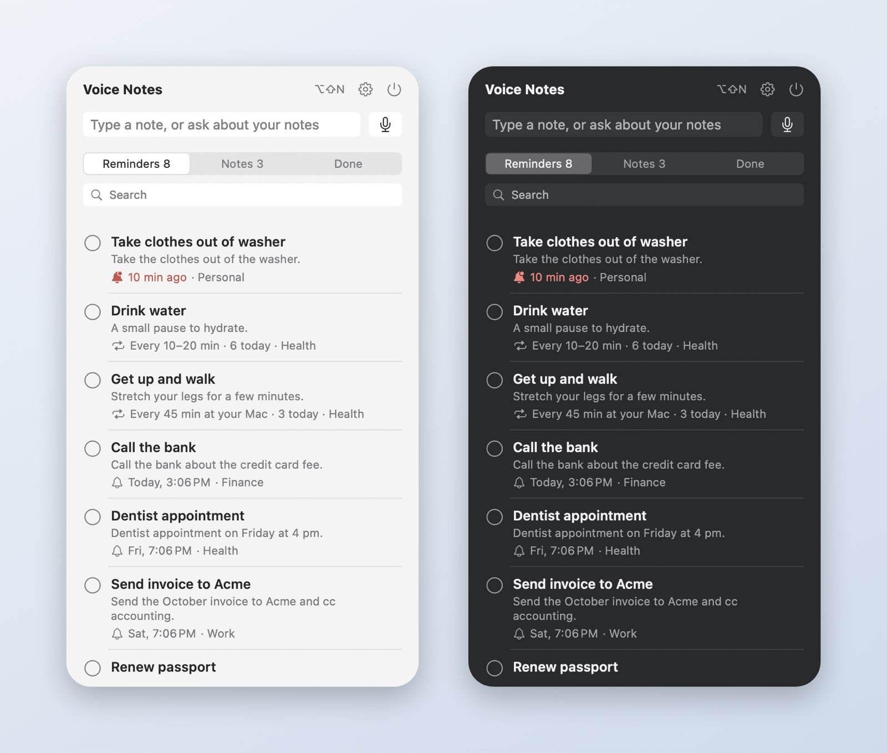
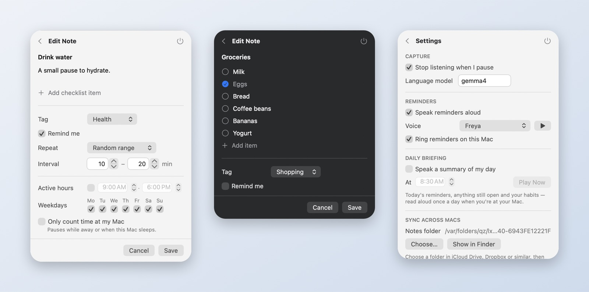

<p align="center"></p>

<h1 align="center">Voice Notes</h1>

<p align="center"><b>Sticky notes you speak. Smart reminders. 100% on your Mac.</b><br>
A free, open-source menu bar app powered by a local AI — no account, no cloud, no subscription.</p>

<p align="center">
  <a href="https://github.com/nileshkr9919/voice-notes/releases/latest"></a>
  <a href="https://github.com/nileshkr9919/voice-notes/actions/workflows/ci.yml"></a>
  
  
  <a href="LICENSE"></a>
</p>

<p align="center"></p>

Press **⌥⇧N** anywhere, say what's on your mind, and it becomes a tidy note — with a reminder if you mentioned a time, a checklist if you listed things, or a repeating nudge if it's a habit. A local AI ([Ollama](https://ollama.com)) does the understanding, so your notes never leave your Mac.

> "Remind me to call the bank tomorrow at 11" → **Call the bank** · tomorrow 11:00 AM
> "Buy milk, eggs, bread and coffee" → **Groceries** ☐ Milk ☐ Eggs ☐ Bread ☐ Coffee
> "Drink water every 10–20 minutes" → **Drink water** · repeats, only while you're at your Mac
> "What's the Wi-Fi password at Mom's?" → *"It's sunflower42."* — answered from your notes
> "Mark milk done" · "Snooze water for an hour" · "Pause habits until 3"

## Install

Open **Terminal** (⌘-Space → "Terminal"), paste this and press Return:

```sh
curl -fsSL https://raw.githubusercontent.com/nileshkr9919/voice-notes/main/install.sh | zsh
```

That's it — nothing needs to be installed first. The installer sets up Ollama, downloads the AI models (about 11 GB, first time only), installs Voice Notes into your Applications folder and opens it. Click **Allow** when macOS asks for Microphone, Speech Recognition and Notifications. Run the same line again to update.

**Requirements:** macOS 14 Sonoma or later · ~15 GB free disk · 16 GB memory recommended (on 8 GB, use a smaller model: `curl … | MODEL=llama3.2 zsh`).

## Features

- 🎙 **Speak or type** — ⌥⇧N from anywhere; listening stops when you pause. Or just start typing when the popover is open.
- ⏰ **Reminders that understand you** — "tomorrow at 9", "Friday at 4", "in 20 minutes", "tonight". Notifications with Snooze and Done, read aloud in one of 38 voices. They still appear even if the app is quit.
- 💧 **Smart habits** — "drink water every 10–20 minutes", "get up and walk frequently". Active hours and weekdays; never while you're away, on a call, or after a break you already took. Done counts ("6 today") and keeps going.
- ✅ **Checklists** — spoken lists become tickable items, right in the menu bar.
- 🔎 **Ask your notes** — questions are answered from your notes, locally.
- 🗣 **Commands** — "mark milk done", "I drank water", "snooze water for an hour", "delete the dentist note", "pause habits until 3".
- ☀️ **Daily briefing** (optional) — a spoken summary of today's reminders and habits each morning.
- 🔁 **Sync across your Macs** through iCloud Drive, Dropbox or any synced folder — no server.
- 🔐 **Optional end-to-end encryption** — AES-256-GCM with a passphrase; your sync provider sees only ciphertext.
- ⌨️ **Keyboard-first** — ↑/↓, Space to complete, Return to edit, ⌫ to delete, ⌘F to search.
- 🍏 **Native macOS** — SwiftUI, light and dark mode, VoiceOver labels, tiny footprint.

<p align="center"></p>

## Sync across your Macs
Voice Notes doesn't run a server. Instead it can keep notes in a folder that your existing sync service shares:

1. On your first Mac: **Settings → Sync across Macs → Choose…** and pick (or create) a folder in **iCloud Drive**, Dropbox, Google Drive, OneDrive or Syncthing. Your notes are copied there.
2. On each other Mac: install Voice Notes and choose the **same folder**. Notes from both Macs are merged.
3. Optional: turn off **Ring reminders on this Mac** on Macs where you don't want alerts. Either way, each reminder rings on only one Mac.

Each note is a small JSON file. When the same note is edited on two Macs, the newest edit wins, and deletions sync too.

## Privacy
- Optional **end-to-end encryption** (Settings → Sync across Macs → Encrypt Notes): notes are sealed with AES-256-GCM using a key derived from your passphrase (PBKDF2-SHA256), so a sync provider or anyone with access to the folder sees only ciphertext. The key stays in each Mac's Keychain; enter the passphrase once per Mac. **There is no recovery if you forget the passphrase.**
- Speech is transcribed on-device by macOS.
- Notes are understood by the AI model running in Ollama on your Mac (`localhost:11434`).
- Notes are stored as files in `~/Library/Application Support/VoiceNotes/Notes/` or in the folder you chose.
- Nothing is sent anywhere else. There's no telemetry.

## Troubleshooting
| Problem | Fix |
|---|---|
| "Ollama isn't running" banner | Open **Ollama** from Applications. |
| "Missing model" banner | Run the install command again. |
| Mic button does nothing | Use the **Open Settings** button in the app, or System Settings → Privacy & Security → Microphone / Speech Recognition → enable Voice Notes. |
| Reminders didn't fire | Turn on **Open at login**. Reminders missed while the Mac slept fire when it wakes. Check **Ring reminders on this Mac**. |
| First note takes a few seconds | The model is loading into memory. It's pre-loaded while you speak and kept warm for 15 minutes. |
| Notes don't appear on my other Mac | Make sure both Macs chose the same folder, and that the sync service has finished syncing (with iCloud, the folder must be downloaded, not "Optimized"). |

**Uninstall:** quit Voice Notes, then delete `~/Applications/VoiceNotes.app`. Your notes stay in their folder until you delete it.

## For developers
```sh
git clone https://github.com/nileshkr9919/voice-notes && cd voice-notes
./install.sh          # from a checkout this builds from source (installs Command Line Tools if needed)
swift test            # unit tests
./build.sh --install  # rebuild and relaunch after changes
```
See [CONTRIBUTING.md](CONTRIBUTING.md) for the code map and how sync works.

**Releasing:** push a tag like `v1.1.0`. GitHub Actions runs the tests, builds a universal app and publishes it as `VoiceNotes.zip` on the release, which is what the installer downloads.

## License
[MIT](LICENSE)
