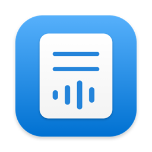

<p align="center"></p>

# Voice Notes

**Sticky notes you speak — free, private and fully on your Mac.**

Voice Notes lives in your menu bar. Press **⌥⇧N**, say what's on your mind, and it becomes a tidy note — with a reminder if you mentioned a time. A local AI (via [Ollama](https://ollama.com)) does the understanding, so there are no accounts, no subscriptions and no cloud.

> "Remind me to pay rent tomorrow" → **Pay rent** · finance · tomorrow 9:00 AM
> "Dentist appointment Friday at 4" → **Dentist appointment** · health · Fri 4:00 PM
> "Buy milk eggs and bread" → **Groceries to buy** · shopping

## Install (no technical knowledge needed)

1. Open **Terminal** (press ⌘-Space, type `Terminal`, press Return).
2. Paste this line and press Return:
   ```sh
   curl -fsSL https://raw.githubusercontent.com/nileshkr9919/voice-notes/main/install.sh | zsh
   ```
3. Wait for **All set!** The first install downloads about 11 GB of AI models, so it can take a while.
4. Click **Allow** when macOS asks for Microphone, Speech Recognition and Notifications.

You don't need anything installed beforehand. The installer sets up Ollama, downloads the models, and installs a ready-made Voice Notes app into your Applications folder. To update, run the same line again.

**Requirements:** macOS 14 Sonoma or later, about 15 GB free disk space, and 16 GB of memory recommended (8 GB works with a smaller model: `MODEL=llama3.2` before `zsh` in the command above).

## Using it
- **Capture:** click the menu bar icon, or press **⌥⇧N** anywhere. Listening stops when you pause (or press ⌥⇧N again). You can also type.
- **Habits:** "remind me to drink water every 10–20 minutes" or "get up and walk frequently" repeat smartly: only during active hours, never while you're away or on a call, and walk reminders count only time at your Mac.
- **Checklists:** "buy milk, eggs, bread and coffee" becomes a list you can tick off right in the popover.
- **Reminders:** a notification with **Snooze** and **Done**, read aloud in one of 38 voices (Settings → Voice). The menu bar shows how many reminders need attention.
- **Find notes:** Reminders / Notes / Done tabs and search. Double-click to edit; right-click to snooze, reschedule, copy or delete (with undo).
- **Turn on Settings → Open at login** so reminders always fire.

## Sync across your Macs
Voice Notes doesn't run a server. Instead it can keep notes in a folder that your existing sync service shares:

1. On your first Mac: **Settings → Sync across Macs → Choose…** and pick (or create) a folder in **iCloud Drive**, Dropbox, Google Drive, OneDrive or Syncthing. Your notes are copied there.
2. On each other Mac: install Voice Notes and choose the **same folder**. Notes from both Macs are merged.
3. Optional: turn off **Ring reminders on this Mac** on Macs where you don't want alerts. Either way, each reminder rings on only one Mac.

Each note is a small JSON file. When the same note is edited on two Macs, the newest edit wins, and deletions sync too.

## Privacy
- Speech is transcribed on-device by macOS.
- Notes are understood by the AI model running in Ollama on your Mac (`localhost:11434`).
- Notes are stored as files in `~/Library/Application Support/VoiceNotes/Notes/` or in the folder you chose.
- Nothing is sent anywhere else. There's no telemetry.

## Troubleshooting
| Problem | Fix |
|---|---|
| "Ollama isn't running" banner | Open **Ollama** from Applications. |
| "Missing model" banner | Run the install command again. |
| Mic button does nothing | Use the **Open Settings** button in the app, or System Settings → Privacy & Security → Microphone / Speech Recognition → enable Voice Notes. |
| Reminders didn't fire | Turn on **Open at login**. Reminders missed while the Mac slept fire when it wakes. Check **Ring reminders on this Mac**. |
| First note takes a few seconds | The model is loading into memory. It's pre-loaded while you speak and kept warm for 15 minutes. |
| Notes don't appear on my other Mac | Make sure both Macs chose the same folder, and that the sync service has finished syncing (with iCloud, the folder must be downloaded, not "Optimized"). |

**Uninstall:** quit Voice Notes, then delete `~/Applications/VoiceNotes.app`. Your notes stay in their folder until you delete it.

## For developers
```sh
git clone https://github.com/nileshkr9919/voice-notes && cd voice-notes
./install.sh          # from a checkout this builds from source (installs Command Line Tools if needed)
swift test            # unit tests
./build.sh --install  # rebuild and relaunch after changes
```
See [CONTRIBUTING.md](CONTRIBUTING.md) for the code map and how sync works.

**Releasing:** push a tag like `v1.1.0`. GitHub Actions runs the tests, builds a universal app and publishes it as `VoiceNotes.zip` on the release, which is what the installer downloads.

## License
[MIT](LICENSE)
